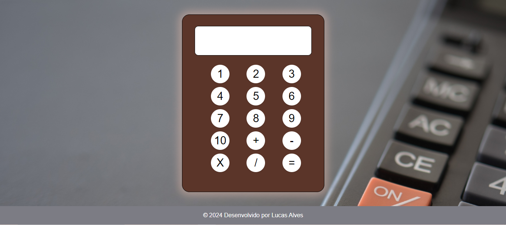

# Calculadora

Calculadora web para praticar manipulação do DOM, eventos e operações aritméticas com HTML, CSS e JavaScript.



## Recursos

- Soma, subtração, multiplicação e divisão.
- Entrada por botões e teclado.
- **Enter** para calcular, **Escape** para limpar e **Backspace** para apagar o último caractere.
- Exibição de “Erro” quando a avaliação da expressão lança uma exceção.

## Como visualizar

```bash
git clone https://github.com/alvesvslucas/Calculadora.git
cd Calculadora
```

Abra `index.html` em um navegador.

## Estrutura

- `index.html`: visor e botões.
- `app.js`: eventos e avaliação das expressões.
- `style.css`: estilos e animação.
- `arquivo/`: fundo e captura de demonstração.

## Escopo

Exercício de calculadora básica. A avaliação atual utiliza `eval`; o projeto não implementa regras próprias de precisão decimal ou tratamento específico de divisão por zero.

